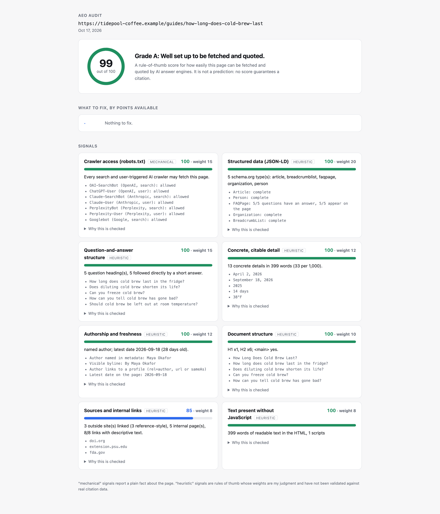
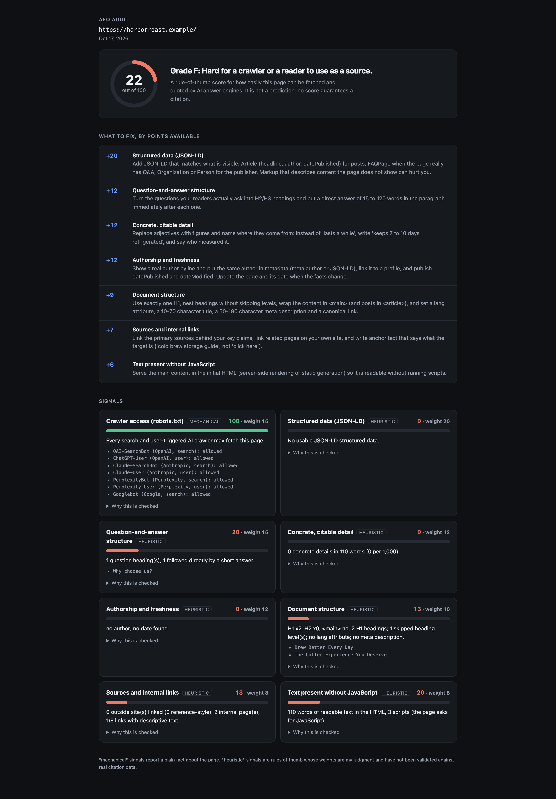
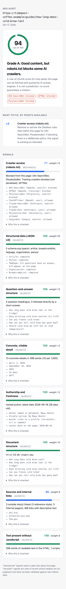

# aeo-audit

**Audit how well a web page is set up to be found, fetched and quoted by AI answer engines, and see exactly what to fix.**

Point it at a URL (or a saved page). It checks which AI crawlers robots.txt lets in, how complete and honest the structured data is, whether headings ask questions and answer them straight away, how much concrete detail the text has, who wrote the page and when, and whether the text exists without running JavaScript. You get a score, a ranked fix list, and a self-contained HTML report. Zero runtime dependencies, Python 3.12+.



[](https://github.com/Nadimul96/aeo-audit/actions/workflows/ci.yml)
[](LICENSE)


## Why it's interesting

- **It says what it does not know.** Every signal is labelled *mechanical* (a plain fact, like robots.txt blocking a crawler) or *heuristic* (a rule of thumb). The weights are my judgment and have not been validated against real citation data, and the report says so ([`docs/design.md`](docs/design.md#two-kinds-of-signal-labelled-as-such)).
- **A real robots.txt matcher.** Python's `urllib.robotparser` has no path wildcards and uses first-match. [`robots.py`](src/aeo_audit/robots.py) implements RFC 9309: group selection by product token, merged groups, `*` and `$`, longest match wins, `Allow` wins ties.
- **A fetcher that cannot be aimed at your network.** Every redirect hop is resolved, every address must be globally routable, and the socket connects to the vetted IP while TLS still checks the host name ([`fetch.py`](src/aeo_audit/fetch.py)). Tests cover private ranges, IPv6, redirects into private space, and resolve-once pinning.
- **Honest structured data.** FAQ markup earns credit only for questions that have answers and also appear on the page ([`signals/structured.py`](src/aeo_audit/signals/structured.py)).
- **Tested by direction, not by faith.** With no ground truth to validate against, Hypothesis applies random sequences of edits and asserts that removing good things never raises the score and adding them never lowers it ([`tests/test_metamorphic.py`](tests/test_metamorphic.py)).
- **Training crawlers are reported, not penalised.** Blocking a training crawler is a policy choice; only crawlers that build or fetch for live answers count ([`agents.py`](src/aeo_audit/agents.py)).

## Quickstart

No keys, accounts or network needed for the demo.

```sh
git clone https://github.com/Nadimul96/aeo-audit && cd aeo-audit
uv run aeo-audit demo
```

The demo audits two synthetic pages bundled with the package (a well-built article and a weak marketing page), plus the good page again behind a robots.txt that blocks two search crawlers. It prints each audit and writes three HTML reports to `aeo-demo/` (output abbreviated):

```text
Score 99/100  Grade A      <- well-structured.html
Score 22/100  Grade F      <- thin.html
Same good page, but robots.txt blocks OAI-SearchBot and PerplexityBot:
  score 94/100, blocked: OAI-SearchBot, GPTBot, PerplexityBot
```

Audit a real page:

```sh
uv run aeo-audit audit https://example.com/some-article --html report.html
```

Other options: `--json` for machine-readable output, `--fail-under 70` to exit 1 in CI when the score is lower, `--offline page.html --robots robots.txt --url https://…` to audit saved files, and `--allow-private` to audit a site running on your own machine. Exit codes: 0 ok, 1 score below `--fail-under`, 2 the page could not be fetched.

As a library:

```python
from aeo_audit import audit_html, render_report

audit = audit_html(html, "https://example.com/post", robots_text=robots)
print(audit.score, audit.grade, [r.fix for r in audit.recommendations])
open("report.html", "w").write(render_report(audit))
```

## How it works

```text
URL ──fetch (SSRF-checked)──▶ HTML ──parse──▶ Page ─┐
  └──fetch /robots.txt────────────────▶ RFC 9309 ───┼──▶ 8 signals ──▶ score, grade, ranked fixes ──▶ text / JSON / HTML
                                                    │      (each: score, weight, basis, evidence, fix)
```

`audit_html` is pure: the same HTML, robots.txt and clock always give the same audit, which is what makes the metamorphic tests possible. `audit_url` adds the fetching.

| Signal | Weight | Basis | Looks at |
| --- | --- | --- | --- |
| Crawler access | 15 | mechanical | robots.txt rules per AI crawler for this page's path |
| Structured data | 20 | heuristic | JSON-LD types, completeness, FAQ markup matching visible text |
| Question-and-answer structure | 15 | heuristic | question headings followed by a 15-120 word answer |
| Concrete, citable detail | 12 | heuristic | figures, dates, units and attributions per 1,000 words |
| Authorship and freshness | 12 | heuristic | named author, profile link, published and modified dates, age |
| Document structure | 10 | heuristic | one H1, no skipped levels, landmarks, title, description, canonical |
| Sources and internal links | 8 | heuristic | outside and reference-style sources, internal links, anchor text |
| Text without JavaScript | 8 | heuristic | readable text present in the served HTML |

## Screenshots

| Weak page, dark | Blocked crawlers, mobile |
| --- | --- |
|  |  |

## Configuration

There is no config file or environment variable. The audit is controlled by flags (see above) and, in code, by the arguments of `audit_html` and `audit_url`. The crawler list lives in [`agents.py`](src/aeo_audit/agents.py) and the weights in [`signals/context.py`](src/aeo_audit/signals/context.py); both are meant to be edited.

## Development

```sh
uv sync
uv run ruff check . && uv run ruff format --check .
uv run mypy                # strict
uv run pytest -q           # 128 tests, about 8 seconds, no external network
```

The tests cover the RFC 9309 matcher, the parser on hostile markup, each signal, the SSRF guards and fetcher against a local server, the CLI, and the metamorphic properties. I also broke six rules by hand and confirmed the suite failed each time; that was a spot check, not a mutation-testing run.

## Status and limitations

- **Heuristics, not measurements.** Nothing here has been checked against real citation data, so a high score does not predict being cited and following every fix is not known to raise your chances. Treat it as a checklist for fetchability and clarity.
- **Static HTML, one page at a time.** No JavaScript is executed and there is no site crawl. Pages that only render in a browser will score low on purpose.
- **The crawler list is a snapshot.** The tokens are the ones vendors documented as of October 2026; check each vendor's crawler page, because they change.
- **English-biased text rules.** Byline, attribution and unit patterns, and the question-mark rule, assume English text.
- **Robots limits.** Percent-encoding normalisation is not implemented, and only the audited page's own path is checked.
- **Network scope.** Redirects and robots.txt use the same SSRF checks, but there is no proxy support and plain `http://` is allowed.
- The bundled demo pages are synthetic; "Tidepool Coffee" and "Harbor Roast" are made-up businesses and every figure in them is invented.

## License

MIT, see [LICENSE](LICENSE).
